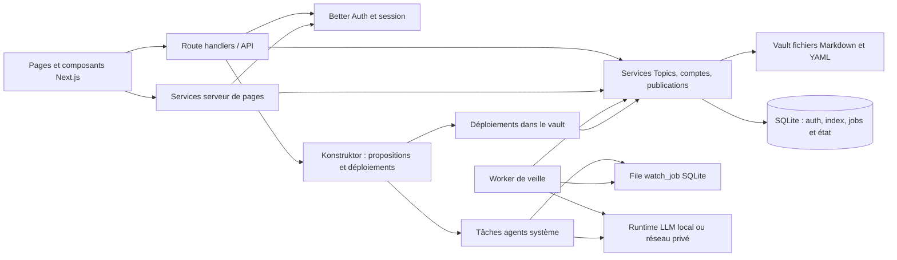
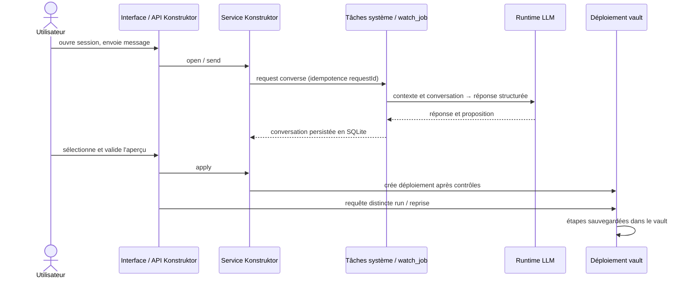

# Architecture applicative — phase 2, lot A1

Référence : `4d333e4a2d1c40670d71f8d7fb6d3771b16d59b2`, branche `main`. Reconnaissance statique ciblée du 6 novembre 2026 ; aucun service lancé ni test exécuté. Ce document est **provisoire** : A1 couvre les points d'entrée et les flux majeurs demandés ; A2 approfondira les comportements, cas limites et branchements non établis. Les lignes renvoient aux fichiers à ce commit. Les succès CI historiques figurent dans `work/evidence/phase-1-H2-github.md`, sans établir à eux seuls le fonctionnement de ces flux.

**Certitude** : élevée = relation d'appel ou écriture lue directement dans le code ; moyenne = chemin partiellement suivi ou conditionnel ; indéterminée = lien pas encore démontré. « Raccordé » signifie ici **raccordement statique observé**, non parcours exécuté ni validé. Les citations sont reproductibles avec `nl -ba <fichier>`.

## Vue d'ensemble

### Composants et points d'entrée

- **Présentation / serveur** — Next.js App Router : pages `src/app/auth/` et `src/app/dashboard/`, composants React dans `src/components/`, routes HTTP dans `src/app/api/`. Le layout du dashboard appelle `getCurrentUser` (`src/app/dashboard/layout.tsx:8`), la page de propositions Konstruktor charge `SuggestionInbox` (`src/app/dashboard/konstruktor/page.tsx:1`). `src/app/api/feed/route.ts:9`, `src/app/api/topics/route.ts:5` et `src/app/api/konstruktor/sessions/route.ts:8` illustrent les points d'entrée. Next 15.4.5 et React 19.1.0 sont déclarés dans `package.json`. **Élevée**, existence et exemples ; couverture de toutes les routes non revue.
- **Identité et comptes** — `src/app/api/auth/[...all]/route.ts:6` délègue à Better Auth ; `src/lib/auth.ts:8` ouvre SQLite, vérifie la configuration et construit l'authentification. `src/lib/current-user.ts:9` résout la session côté page ; `src/lib/publications/server.ts:39` en extrait le viewer utilisé par les API. Les comptes éditoriaux/agents ont un store distinct (`src/lib/accounts/server.ts:1`, `src/lib/xiagents/server.ts:13`) : ne pas les confondre avec les comptes de connexion. **Élevée** pour ces liens ; modèle des droits complet à approfondir.
- **Topics, graphe et recherche** — `src/lib/topics/server.ts:8` construit le store à partir du vault et de SQLite ; `:20` ajoute le store de relations avec contrôle via publications lisibles. `src/lib/graph/server.ts:12` assemble service graphe, repository, vault, base et publications ; ne pas supposer qu'il est identique au réseau de Topics. `src/lib/search/server.ts:19` combine Topics visibles et agents visibles ; `:42` résout une recherche et peut ouvrir un Topic personnel après soumission explicite. La découverte à partir de publications est une autre chaîne (`src/lib/topics/discovery.ts:241`). **Élevée** pour l'assemblage, **moyenne** pour la sémantique complète.
- **Publications et interactions** — `src/lib/publications/server.ts:16` construit le store vault/SQLite et démarre un watcher ; `src/lib/publications/store.ts:375` crée une publication éventuellement liée à une réponse, `:756` publie, `:933` charge une conversation. `src/lib/publications/conversation.ts:10` construit l'arbre des réponses ; les routes feed/conversations utilisent ces services. **Élevée** pour les appels cités ; droits et tous types d'interactions restent à inventorier.
- **ΞAgents et coordination** — `src/lib/xiagents/server.ts:13` produit les résumés d'agents, `src/lib/xiagents/deployments.ts:185` gère des déploiements multiétapes, `src/lib/system-agents/registry.ts:28` enregistre Konstruktor et l'Arbitre prioritaire. Ce dernier est distinct de Konstruktor ; la coordination de tâches est assurée par la file et le worker de veille. **Élevée**.
- **Sources, veille et IA** — `scripts/watch-worker.ts:70` assemble découverte de Topics, services système et handlers du moteur de veille ; `src/lib/watch/worker.ts:167` relie collecte, découverte de sources, évaluation, rédaction et publication ; `src/lib/llm/server.ts:40` construit le runtime d'inférence et `:74` résout le modèle. `src/lib/watch/inference.ts:43` prévoit des serveurs Ollama ou compatibles API OpenAI, soumis à une politique de destinations ; l'accès réel à un serveur n'est pas établi. **Élevée** pour le câblage, pas pour l'exécution.

## Identité, stockage et configuration

`src/middleware.ts:3` effectue une redirection rapide selon la présence du cookie ; la validation de session est effectuée par `getCurrentUser` (`src/lib/current-user.ts:9`) et par les wrappers de routes. Par exemple `systemAgentResponse` obtient le viewer puis compare l'origine des requêtes non GET (`src/lib/system-agents/http.ts:11`) ; `accountResponse` et `topicResponse` ont des vérifications analogues (`src/lib/accounts/http.ts:10`, `src/lib/topics/http.ts:8`). Ces exemples ne constituent pas un audit exhaustif d'autorisation.

`createAuth` ouvre `AUTH_DATABASE_PATH` (par défaut `./data/xi-auth.sqlite`) avec WAL et clés étrangères (`src/lib/auth.ts:8`) ; `getAppDatabase` réutilise cette connexion (`:47`). SQLite contient notamment identité, réglages, index, tâches et historiques : voir `src/lib/watch/jobs.ts:22`, `src/lib/watch/orchestrator.ts:57`, `src/lib/konstruktor/store.ts:11`, `src/lib/llm/store.ts:24`. Les index de publications et de graphe sont des projections reconstructibles (`src/lib/publications/index-db.ts:4`, `src/lib/maintenance/migration-check.ts:44`) ; il serait faux d'en déduire que toute la base est jetable.

Le vault `XI_VAULT_PATH` doit être absolu et déjà exister ; l'ouverture peut y créer `posts/` (`src/lib/publications/vault.ts:16`). Les services Topics, comptes et publications y accèdent également ; les déploiements sont enregistrés dans `.xi-deployments/*.md` (`src/lib/xiagents/deployments.ts:185`). Les opérations sur vault et SQLite traversent donc deux supports ; atomicité globale et récupération après panne restent à examiner.

`pnpm db:migrate` appelle `scripts/migrate-auth.ts:6` : migrations Better Auth puis `migrateSchemas` et propriétaire d'instance. Plusieurs stores appliquent aussi leurs migrations à l'initialisation. `src/lib/maintenance/migration-check.ts:73` implémente une répétition sur copie SQLite/vault ; elle n'a pas été exécutée ici. `.env.example` documente notamment `BETTER_AUTH_*`, `AUTH_DATABASE_PATH`, `XI_VAULT_PATH`, `XI_INFERENCE_*`, `XI_WATCH_*` et `XI_TOPIC_AUTOACCEPT` ; aucune valeur de configuration locale n'a été lue. **Certitude élevée** pour les mécanismes cités, compatibilité et rollback non démontrés.

## Flux applicatifs observés

### Session → utilisateur → données — raccordé statiquement, confiance élevée

`/api/auth/[...all]` → `getAuth` / Better Auth → session en SQLite ; le dashboard appelle `getCurrentUser` et les routes utilisent notamment `getViewer` → store du domaine (`src/app/api/auth/[...all]/route.ts:1`, `src/lib/current-user.ts:9`, `src/lib/publications/server.ts:39`). Le middleware ne remplace pas la vérification de session. Isolation complète des données entre utilisateurs à vérifier par domaine.

### Topic → recherche → sources — raccordements distincts, confiance moyenne

La recherche de catalogue passe par `searchData` / `searchTarget`, puis par les Topics et comptes visibles (`src/lib/search/server.ts:19`). La veille, elle, planifie collecte et découverte de sources pour les agents (`src/lib/watch/worker.ts:249`, `src/lib/watch/collect.ts:65`) ; les sources et la configuration des agents sont associées à des Topics, notamment lors d'un déploiement (`src/lib/xiagents/deployments.ts:387`). **Aucun appel direct recherche utilisateur → découverte de sources n'a été démontré en A1** : ne pas présenter ces mécanismes comme un seul parcours. À l'inverse, `createTopicDiscovery` planifie l'enrichissement de publications publiques et des propositions de relations (`src/lib/topics/discovery.ts:18`, `:260`, `:276`), à condition qu'un worker passe.

### ΞAgent → moteur IA → résultat — raccordé sous conditions, confiance élevée sur le chemin manuel

`POST /api/xiagents/[id]/generate` → `generatePublication` → compte propriétaire, agent actif, candidat accepté associé à un Topic → résolution LLM → `writeCandidateDraft` → brouillon privé et enregistrement de run (`src/app/api/xiagents/[id]/generate/route.ts:15`, `src/lib/xiagents/publication-generator.ts:41`). La réponse est un brouillon ; le code indique explicitement qu'il ne publie pas (`:72`). Modèle configuré et candidat approprié sont nécessaires ; aucun appel réel au modèle n'a été effectué.

### Veille / recherche → publication — raccordé par étapes et conditions, confiance moyenne

Worker `tick` → planification des collectes et découvertes → évaluation → rédaction → synchronisation de la file éditoriale → diffusion (`src/lib/watch/worker.ts:167`, `:242`, `:269`). Les handlers reçoivent sources, Topics, comptes, publications et runtime LLM ; le diffuseur peut appeler `publishWatchDraft` après contrôles (`src/lib/watch/publisher.ts:266`). Les drapeaux d'autopublication et de visibilité sont lus dans `publishSettingsFromEnv` (`:54`), ainsi que les politiques et calendriers d'agents. Chaîne statiquement présente, résultats réels et prise en compte des sources à valider en A2/F5/V2. Ne pas confondre ce circuit avec la recherche de catalogue utilisateur.

### Publication → réponse → mention — partiellement démontré, confiance moyenne

`create(viewer, replyTo)` vérifie une référence de réponse (`src/lib/publications/store.ts:375`), `conversation` expose le fil (`:933`) et `conversationTree` organise les relations (`src/lib/publications/conversation.ts:10`). Une mention structurée **interne** d'un agent éditorial vers `@arbitre` existe dans le circuit d'alerte (`src/lib/watch/publisher.ts:359`, `src/lib/arbiter/arbitration.ts:10`) ; elle n'est pas un message du fil social. Un trajet général publication → commentaire → mention d'utilisateur ou d'agent dans l'interface n'a pas été établi : à rechercher sans conclure à son absence.

### Konstruktor → configuration → déploiement ; exécution → persistance → reprise — raccordé sous conditions, confiance élevée sur le code

Le message demande une tâche système, dont l'exécution consulte le modèle et enregistre propositions et réponse ; la validation utilisateur crée un déploiement, puis une **requête distincte** le lance ou reprend (`src/lib/konstruktor/service.ts:121`, `:176`, `src/app/api/xiagents/deployments/[id]/route.ts:10`). Cette opération configure agents et Topics ; elle ne prouve pas que Konstruktor déclenche lui-même l'ensemble de leurs exécutions de veille. La file `watch_job` utilise des baux, jetons et reprises après expiration (`src/lib/watch/jobs.ts:106`) ; les déploiements persistés dans le vault reprennent leurs étapes non terminées (`src/lib/xiagents/deployments.ts:350`). Une reprise exige un processus ou une requête ultérieure ; aucune garantie de reprise effective après panne n'a été testée.

## Konstruktor : architecture effective

- **Responsabilités** : agent système `konstruktor`, capacités déclarées conversation de configuration, aperçu et suggestions (`src/lib/system-agents/registry.ts:28`). `createKonstruktor` expose `open`, `list`, `view`, `send`, `configuration`, `decide`, `apply`, `preview`, `suggestions` et `review` (`src/lib/konstruktor/service.ts:59`, `:251`). Il charge le contexte de l'utilisateur, des Topics, des comptes et modèles (`src/lib/konstruktor/context.ts:43`). **Élevée**.
- **Interfaces** : page de suggestions `src/app/dashboard/konstruktor/page.tsx:1` ; routes de sessions `src/app/api/konstruktor/sessions/route.ts:7`, messages, décisions, aperçu, application, suggestions et reviews dans `src/app/api/konstruktor/`. Elles passent par `systemAgentResponse` qui utilise une session et vérifie l'origine des écritures (`src/lib/system-agents/http.ts:11`). L'ensemble des écrans et contrôles n'a pas été parcouru. **Élevée** pour les exemples.
- **Dépendances** : `getKonstruktor` assemble base, tâches système, comptes, Topics, sources, modèles et déploiements (`src/lib/konstruktor/server.ts:12`). Sessions, messages, décisions et aperçu sont stockés en SQLite (`src/lib/konstruktor/store.ts:11`) ; l'exécution de `converse` lit le contexte, appelle `askJson` et conserve réponse et proposition (`src/lib/konstruktor/converse.ts:238`). Les suggestions proactives sont planifiées depuis le worker (`scripts/watch-worker.ts:79`, `src/lib/konstruktor/suggestions.ts:314`). **Élevée** pour les appels ; disponibilité et qualité du modèle non démontrées.
- **Validation et déploiements** : `apply` vérifie cible et décisions puis crée le déploiement (`src/lib/konstruktor/service.ts:176`) ; la requête distincte `POST /api/xiagents/deployments/[id]` lance ou reprend (`src/app/api/xiagents/deployments/[id]/route.ts:10`). Fichiers de déploiement, verrou par déploiement, contrôles préalables et journal d'étapes sont dans `src/lib/xiagents/deployments.ts:185`, `:301`, `:350`. Les contrôles et garanties annoncées n'ont pas été testés en A1. **Élevée** pour le chemin statique.
- **Arbitrage et ordonnancement** : `priority-arbiter` est un autre agent système, chargé d'une décision sur alerte prioritaire (`src/lib/system-agents/registry.ts:36`, `src/lib/arbiter/decide.ts:42`). Sa mention est interne ; une décision favorable permet une nouvelle tentative soumise aux contrôles de publication, elle ne publie pas elle-même (`src/lib/arbiter/arbitration.ts:10`). La planification, les calendriers, priorités, limites de concurrence et exécutions sont dans `src/lib/watch/orchestrator.ts:12`, `:28`, `src/lib/watch/worker.ts:242` et `src/lib/watch/jobs.ts:106` : ce moteur est distinct de Konstruktor, même s'il exécute ses tâches et programme ses revues. **Élevée** sur ces responsabilités ; limites de concurrence en situation réelle à vérifier.

## Incohérences et dépendances à examiner

1. **Migrations et documentation** — `src/lib/maintenance/migration-check.ts:31` affirme que chaque étape ne fait que créer ou ajouter. Or `src/lib/watch/evaluate.ts:58` reconstruit conditionnellement `watch_candidate` avec renommage et suppression de l'ancienne table, et `src/lib/publications/index-db.ts:22` supprime des tables d'index dérivées lors d'un changement de version. Les traitements prévoient copie des lignes ou reconstruction des index ; ceci établit une formulation imprécise, pas une perte de données prouvée. Examiner migrations, rollback et versions concurrentes sur copie isolée. **Confiance élevée sur la divergence documentaire ; impact non déterminé.**
2. **Autopublication en développement** — `scripts/watch-dev.ts:20` force `XI_WATCH_AUTOPUBLISH=true` et `XI_WATCH_AUTOPUBLISH_PUBLIC=false` pour son processus enfant, alors que `.env.example` met les deux à `false`. `package.json` lance ce worker avec `pnpm dev` ; les autres politiques et contrôles de publication restent applicables. Risque conditionnel de modification de données locales si un environnement réel est utilisé ; pas de publication observée pendant cet audit. **Confiance élevée sur configuration, impact non mesuré.**
3. **Frontières persistantes et disponibilité** — base SQLite, vault, worker, modèle et accès réseau aux sources sont des dépendances différentes. Un service présent dans le web ne démontre pas qu'un worker périodique est démarré en production ; `scripts/watch-dev.ts:3` n'établit que le lanceur de développement. Examiner l'exploitation, la cohérence inter-support et les échecs. **Confiance élevée sur les dépendances, risque non quantifié.**
4. **Documentation historique** — `README.md:3` affirme que la veille IA n'est pas implémentée ; `src/lib/watch/worker.ts:167` câble plusieurs handlers de veille et d'inférence. Le README peut décrire un MVP historique ; fonctionnement, activation et caractère à jour de cette documentation restent à vérifier. **Confiance élevée sur la divergence, portée fonctionnelle à qualifier.**

## À approfondir en A2 et aux phases suivantes

- Tracer finement routes, droits et données de tous les domaines ; distinguer stockage canonique, index, synchronisation et migrations.
- Vérifier le chemin réel Topic → source, la découverte, les protections réseau, la provenance et les déclenchements du worker ; distinguer recherche locale et collecte externe.
- Examiner les mentions sociales et éventuelles collaborations entre agents, sans assimiler les mentions d'arbitrage à des publications.
- Examiner préflight, conflits, verrous, reprise après panne, limites et garanties interprocessus ; déterminer comment le worker est exploité hors développement.
- Tracer les configurations, échecs et réponses des modèles, ainsi que le détail des suggestions et de la validation humaine de Konstruktor.
- Avant toute phase 4, vérifier l'isolation des bases, vaults, services réseau et effets de chaque commande ; le code n'a été ni exécuté ni modifié pendant A1.

## Approfondissement A2 — contrats et garanties observables

Ce complément remplace les incertitudes correspondantes d'A1 ; il reste statique. Les preuves détaillées, commandes et points à tester figurent dans [le registre A2](work/evidence/phase-2-A2-contracts.md). **Confiance élevée** signifie que le mécanisme a été lu dans le chemin cité, non qu'il a été éprouvé en exécution.

### Autorisations et identités

- **Session et origine.** L'identité des pages et Server Actions étudiées provient de la session Better Auth ; le middleware teste d'abord la présence du cookie, puis la session est vérifiée côté serveur (`src/lib/current-user.ts:9`, `src/lib/apis/publications.ts:12`). Les wrappers Topics, comptes et agents système vérifient l'origine des mutations (`src/lib/topics/http.ts:8`, `src/lib/system-agents/http.ts:11`). `publicationResponse` exige une session mais n'effectue pas lui-même ce contrôle (`src/lib/publications/http.ts:9`) ; les mutations publication étudiées utilisent des Server Actions. La couverture et les protections de tous les endpoints restent à vérifier. **Élevée** sur les chemins cités.
- **Publications.** `canRead` autorise l'auteur humain, le gestionnaire d'un agent IA, ou un utilisateur connecté selon statut publié, visibilité publique ou abonnements ; les brouillons sont privés et la corbeille exclue des vues ordinaires (`src/lib/publications/permissions.ts:5`). L'édition et la gestion de corbeille ordinaires passent par l'auteur humain (`:20`, `src/lib/publications/store.ts:328`, `:787`) ; les parcours de brouillons IA disposent de règles distinctes liées au propriétaire de l'agent (`src/lib/publications/store.ts:577`). La lecture par index a un prédicat SQL dédié (`src/lib/publications/index-db.ts:104`). « Publique » ne signifie pas que les routes observées sont anonymes. **Élevée** pour ces règles, équivalence complète des chemins non prouvée.
- **Topics et agents éditoriaux.** Les Topics personnels sont dans un dossier par propriétaire et le contenu est contrôlé (`src/lib/topics/store.ts:76`) ; la visibilité combine catalogue partagé et Topics personnels de l'utilisateur (`:338`). La modification d'un Topic partagé exige créateur, révision courante et validation des relations (`:285`). `accounts.list` filtre agents publics ou propres et `getOwned` vérifie la propriété (`src/lib/accounts/store.ts:88`) ; les mises à jour de configuration vérifient propriété et révision. **Élevée** pour ces méthodes ; pas une preuve d'isolation complète de toute l'application.
- **Administration et agents système.** Le premier compte devient propriétaire d'instance ; seul ce propriétaire peut configurer les agents système, avec comparaison de révision (`src/lib/system-agents/owner.ts:33`, `src/lib/system-agents/store.ts:115`). En cas de disparition, récupération explicitement locale (`owner.ts:63`). Les permissions nommées dans le registre sont déclaratives : la recherche A2 ne trouve pas d'appel à `hasPermission` ailleurs que sa définition (`src/lib/system-agents/registry.ts:15`). Les restrictions observées proviennent notamment du contrôle de propriétaire et du registre de tâches, qui refuse à l'API générique les tâches marquées internes (`src/lib/system-agents/tasks.ts:128`). Il ne faut donc pas supposer un moteur général d'autorisation fondé sur ces étiquettes. **Élevée** sur le code recherché ; exhaustivité des surfaces administratives à confirmer.

### SQLite, vault, transactions et reprise

Les publications, configurations d'agents, Topics et déploiements utilisent des fichiers du vault ; SQLite porte notamment les sessions, index, jobs, exécutions et conversations. Les index de publications et graphe sont des projections reconstruites depuis les fichiers, mais la base contient aussi des données qui ne sont pas identifiées comme reconstructibles. L'écriture `writeAtomic` fait un fichier temporaire, `fsync` et `rename` (`src/lib/publications/vault.ts:66`) : c'est une protection **par fichier**, pas une transaction globale entre plusieurs fichiers et SQLite. Les verrous à base SQLite séparée sérialisent les sections protégées (`src/lib/topics/lock.ts:7`). **Élevée** sur ces mécanismes ; robustesse aux pannes du système de fichiers non testée.

Exemple concret : `publishWatchDraft` écrit le fichier, réindexe puis invoque l'enregistrement de décision (`src/lib/publications/store.ts:577`) ; décision et candidat sont mis à jour dans une transaction SQLite distincte (`src/lib/watch/publisher.ts:288`). Une interruption entre supports peut laisser un état intermédiaire. Le chemin de reprise reconnaît un brouillon déjà publié et reconstitue la décision (`publisher.ts:170`, `:210`), sans prouver que toutes les fenêtres de panne sont couvertes. La réconciliation des publications relit les fichiers, et un watcher ainsi qu'un passage périodique la déclenchent (`src/lib/publications/store.ts:229`, `:263`, `src/lib/publications/runtime.ts:73`). Les Topics utilisent notamment un journal de reprise pour un renommage d'arborescence (`src/lib/topics/store.ts:306`). **Risque de désynchronisation transitoire déduit de l'ordre des opérations, confiance élevée ; perte durable non démontrée.**

La divergence documentaire A1 est confirmée : le commentaire « seulement créer ou ajouter » (`src/lib/maintenance/migration-check.ts:31`) ne décrit pas littéralement la reconstruction transactionnelle de `watch_candidate`, avec copie puis suppression de l'ancienne table (`src/lib/watch/evaluate.ts:58`), ni l'effacement/reconstruction des index dérivés lors d'un changement de version (`src/lib/publications/index-db.ts:22`). Le code prévoit une répétition sur copie avec deux passages et contrôles d'intégrité (`src/lib/maintenance/migration-check.ts:73`) ; elle n'a pas été exécutée. Compatibilité de retour arrière et conservation de toutes les données restent à établir, sans perte constatée ici.

### Tâches, concurrence et fonctionnement hors développement

- `watch_job` persiste `pending`, `running`, `done`, `failed` ; la clé unique déduplique tant que sa ligne existe. La purge des jobs terminés permet ensuite de réutiliser la clé (`src/lib/watch/jobs.ts:80`, `:170`) : l'idempotence n'est donc pas illimitée dans le temps.
- L'acquisition est transactionnelle (`BEGIN IMMEDIATE`), avec bail et jeton ; les transitions de la file exigent le jeton courant (`src/lib/watch/jobs.ts:106`, `:138`). Une expiration rend le job à nouveau éligible, sous réserve des tentatives. Les erreurs transitoires suivent un délai exponentiel borné ; les permanentes échouent, et l'attente ne consomme pas de tentative (`:75`, `:153`). `xiagent_run` conserve des états et journaux de tentatives (`src/lib/watch/orchestrator.ts:57`). **Élevée** pour les transitions de file ; exactement-une-fois des effets externes non démontré.
- `drainJobs` renouvelle le bail, vérifie pause et calendrier, et met le job en attente à une interruption (`src/lib/watch/worker.ts:76`). **Limite statique** : `Promise.race` ne prouve pas l'annulation de la promesse du handler perdante ; aucun signal d'annulation ne lui est passé à cet appel (`:91`). Le retour de `heartbeat` n'est pas utilisé (`:79`). Les jetons protègent les transitions de file, mais il faut vérifier séparément si un handler continuant après pause ou perte de bail peut encore produire des effets. Le mécanisme observé est certain ; un effet indésirable concret reste une hypothèse à tester.
- Le serveur web peut démarrer les tâches système et programmer leur reprise (`src/lib/system-agents/tasks.ts:170`), tandis que le worker périodique peut les reprendre après expiration. Les retries interactifs de modèle indisponible sont bornés à 15 minutes (`:75`). `XI_WATCH_DISABLED=true` empêche le tick et désactive l'autorun des tâches système (`scripts/watch-worker.ts:45`, `src/lib/system-agents/server.ts:37`). Aucun processus ultérieur ne signifie aucune reprise automatique démontrée.
- En développement, `pnpm dev` lance web et boucle `watch-dev`, avec une pause de 60 secondes entre passes (`package.json:6`, `scripts/watch-dev.ts:3`). Hors développement, le dépôt documente un exemple de timer systemd toutes les dix minutes (`docs/watch.md:737`) ; son installation ou fonctionnement sur une machine réelle n'est pas établi. L'échéance de huit minutes fournie par le script borne le démarrage de nouveaux jobs dans la passe (`scripts/watch-worker.ts:110`, `src/lib/watch/worker.ts:125`) ; elle ne prouve pas l'arrêt forcé d'un handler déjà démarré. **Élevée** sur le code et la documentation.

### Contrats Konstruktor et Arbitre

Konstruktor travaille sur le contexte du demandeur : un agent cible passe par `getOwned`, un Topic doit être visible (`src/lib/konstruktor/context.ts:43`). Une conversation produit propositions et aperçu ; `apply` vérifie les IDs de propositions et la correspondance de cible, crée un déploiement soumis à préflight et aux révisions, puis enregistre les décisions (`src/lib/konstruktor/service.ts:152`). L'exécution du déploiement est une requête authentifiée distincte ; les opérations de stores contrôlent ensuite la propriété. La correspondance exacte entre chaque champ de la spec envoyée et les propositions sélectionnées n'a pas été démontrée par A2 ; elle doit être examinée avant toute conclusion sur les protections complètes. **Élevée** sur contrôles cités, **indéterminée** sur ce lien champ par champ.

L'Arbitre reçoit une **demande interne structurée**, persistée avec une clé dérivée de l'agent, de l'actualité et de sa version ; son enregistrement et l'enqueue sont dans une transaction SQLite (`src/lib/arbiter/arbitration.ts:145`). Il décide de la priorité sur la base des éléments fournis (`src/lib/arbiter/decide.ts:42`). Une décision favorable n'écrit pas elle-même de publication : le diffuseur tente ensuite la publication et revérifie ses règles ; indisponibilité, refus ou délai dépassé renvoient au circuit normal (`src/lib/watch/publisher.ts:359`). La validation humaine porte sur la configuration des agents et autorisations de publication ; le verdict d'arbitrage lui-même est autonome. **Élevée** sur le contrat lu, exécution réelle non testée.

### Conditions de publication automatique et mentions

En mode développement, le processus enfant reçoit `XI_WATCH_AUTOPUBLISH=true` et `XI_WATCH_AUTOPUBLISH_PUBLIC=false`, même si l'environnement parent comporte d'autres valeurs (`scripts/watch-dev.ts:20`). Il ne publie pas pour autant systématiquement : `XI_WATCH_DISABLED` doit ne pas arrêter le tick ; l'agent doit être actif, sa politique valide, la veille activée et non en pause, et `policy.autoPublish` activé (`src/lib/watch/publisher.ts:97`). La politique par défaut désactive veille et autopublication et choisit `private` (`src/lib/accounts/types.ts:50`).

Une tentative requiert aussi un candidat `drafted`, un brouillon en attente à la révision attendue, un format conforme, une actualité encore fraîche et inchangée, des sources et affirmations satisfaisant les contrôles, puis les règles de calendrier, seuil, intervalle et plafonds applicables (`src/lib/watch/publisher.ts:116`, `:188`, `:232`, `src/lib/watch/schedule.ts:75`). Hors calendrier, une alerte immédiate exige l'exception événement majeur et un avis favorable de l'Arbitre sur la même version (`publisher.ts:270`). La publication publique exige en plus confirmation enregistrée par le propriétaire **et** drapeau opérateur public (`src/lib/accounts/store.ts:210`, `src/lib/watch/publisher.ts:219`) ; le worker de développement force ce dernier à `false`. Ces gardes sont des conditions lues dans le code, non une garantie d'exécution vérifiée.

Correction d'A1 : les mentions sociales ne sont pas uniquement hypothétiques. `remarkMentions` transforme les `@handle` des nœuds de texte Markdown en liens de profil, en excluant code, URLs et liens existants (`src/components/publications/markdown-view.tsx:10`) ; la page de profils cherche une correspondance accessible unique (`src/app/dashboard/profiles/page.tsx:10`). Ce chemin de rendu ne démontre ni notification, ni appel d'agent, ni traitement automatique d'une mention dans une réponse. La mention d'arbitrage est une structure séparée et interne. **Élevée** sur le lien de rendu, **indéterminée** pour d'autres effets éventuels.

### Vérifications ultérieures à prévoir, après autorisation

1. Sur données jetables : matrices de deux utilisateurs pour sessions, Topics personnels/partagés, publications privées/abonnés, propriété d'agents, propriétaire d'instance, origine et accès aux tâches internes.
2. Sur copies isolées : interruptions entre écriture vault, réindexation et transaction de décision ; reconstruction d'index, migration ancienne, répétition et rollback avec contrôles de contenu.
3. Avec handlers bloqués et horloge contrôlée : pause pendant exécution, expiration/perte de bail, reprise concurrente, seuil de tentatives, purge des clés et absence d'effets en double. Vérifier les effets côté handler, pas seulement la file.
4. Sur environnement temporaire sans réseau externe : toutes les combinaisons utiles des drapeaux opérateur et de la politique de l'agent, calendrier, visibilité, révision, source et arbitrage ; observer les brouillons et publications sans toucher au vault réel.
5. Examiner les parcours de mentions, le lien sélection/spec de Konstruktor, et la mise en service effective du worker ; ne tester les intégrations réelles qu'après identification des prérequis et effets.
